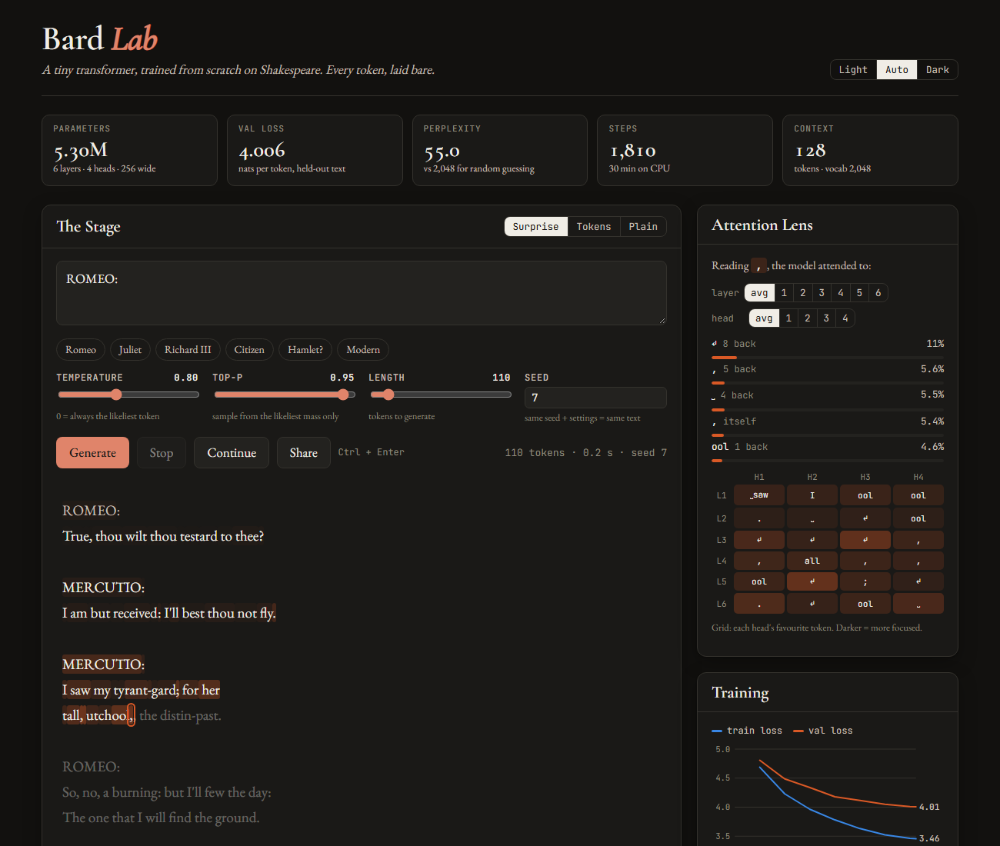
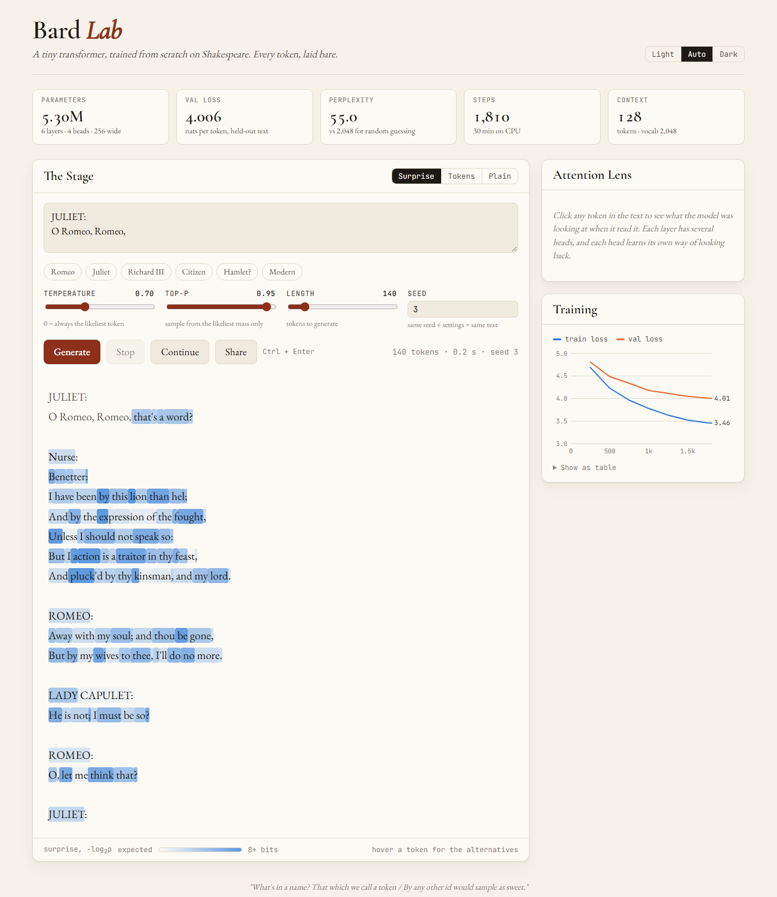

# Bard Lab: a GPT built from scratch, trained on Shakespeare

[](https://github.com/zaindahdul/LLM/actions/workflows/tests.yml)

A complete small language model with no pretrained weights and no `transformers` library: a
byte-level BPE tokenizer, a GPT-style transformer, a training loop, KV-cached sampling and a
web playground that shows what the model is thinking, token by token. Everything trains on a
laptop CPU in 30 minutes.



```
tokenizer.py   byte-level BPE, trained from scratch (2,048-token vocab)
model.py       decoder-only transformer + KV cache + temperature / top-k / top-p sampling
data.py        cached tokenization, contiguous train/val split, batch sampling
train.py       AdamW, warmup + time-budgeted cosine LR, grad clipping, checkpoints, resume
sample.py      stream generated text in the terminal
evaluate.py    exact loss on the full validation split, per token and per character
server.py      stdlib-only web server (Server-Sent Events) for the playground
web/           Bard Lab: the single-page UI
tests/         68 tests: tokenizer, model, generation, data, eval and server
```

## Quick start

```bash
python -m venv .venv && .venv/Scripts/activate      # source .venv/bin/activate on macOS/Linux
pip install -r requirements.txt

python setup_data.py          # download Tiny Shakespeare (1.1 MB) to data/input.txt
python train.py --minutes 30  # train; checkpoints land in checkpoints/
python sample.py              # generate text in the terminal
python server.py              # open http://localhost:8000 for Bard Lab
```

`tokenizer.json` is committed, so you can skip retraining the tokenizer
(`python tokenizer.py --vocab-size 2048` rebuilds it in about 2 seconds).

## Bard Lab

`python server.py` serves a playground where you can watch the model write:

- **Live streaming.** Tokens arrive over Server-Sent Events as they're sampled.
- **Surprise heatmap.** Each token is shaded by how unexpected it was to the model
  (−log₂ p, in bits). Hover a token to see the probability of the one it chose, how many
  options it was effectively choosing among (2^entropy), and its top 5 alternatives.
- **Attention lens.** Click any token to light up the earlier tokens it attended to. Pick a
  layer and head, or use the 6×4 grid, which shows each head's favourite token at a glance.
  Some heads lock onto the previous token, some onto the speaker's name, some onto
  punctuation.
- **Training dashboard.** Shows the train/val loss curve from `checkpoints/log.jsonl` with
  model stats.
- **Shareable links.** `/?prompt=JULIET:%0A&temperature=0.7&seed=3&run` pre-fills the
  controls and starts generating.

## How it works

**Tokenizer.** It starts from the 256 byte values, so any string can be encoded and there
is no `<unk>` token. It then repeatedly merges the most frequent adjacent pair. A GPT-2-style
regex first splits text into words, numbers and punctuation so merges never cross those
boundaries. Training uses frequency-weighted unique chunks and incremental pair-count
updates, so learning 1,792 merges takes seconds rather than minutes.

**Model.** This is a pre-LayerNorm transformer: token + learned position embeddings, then
6 × [causal multi-head attention, then 4×-wide GELU MLP], each on a residual connection.
The output head reuses the token-embedding matrix (weight tying). Residual projections use
GPT-2's 1/√(2·n_layer) init scaling. Attention is written out by hand, and a test checks it
against PyTorch's fused `scaled_dot_product_attention`.

**Training.** AdamW (β₂ = 0.95) with weight decay on weight matrices only. The learning
rate warms up linearly, then follows a cosine decay to 10% of peak, keyed to elapsed time
rather than a step count, so `--minutes 30` always finishes its decay on schedule
regardless of machine speed. Gradients are clipped to norm 1. The best-validation weights
are kept separately from the resumable `last.pt`. Both are written atomically, so a crash
mid-save can't corrupt them.

**Generation.** A KV cache stores each layer's keys and values, so every new token costs
one row of attention instead of a full forward pass over the context. Learned absolute
positions mean the cache can't slide, so when the 128-token window fills, it re-prefills
from the most recent 96 tokens. Tests check cached generation matches a naive no-cache
greedy loop exactly.

## Results

One 30-minute run of `python train.py` on a laptop CPU (8 torch threads, ~2,350 tokens/s):

| | |
|---|---|
| Model | 5.30M parameters: 6 layers, 4 heads, 256 wide, 128-token context |
| Training | 1,810 steps × 2,048 tokens = 3.7M tokens (≈10.6 passes over the training split) |
| Val loss (`evaluate.py`, full split) | **3.99 nats/token**, perplexity **54.2** (random guessing: 2,048) |
| Per character | **1.455 nats/char** (2.10 bits/char) |

For a rough sense of scale, nanoGPT's character-level Shakespeare baseline reports 1.47
nats/char with a 10.7M-parameter model on an A100. Tokenizers and context lengths differ, so
it isn't an exact comparison, but a BPE vocabulary gets a lot out of a small CPU budget.

| step | minutes | train loss | val loss |
|---:|---:|---:|---:|
| 250 | 3.6 | 4.687 | 4.808 |
| 500 | 7.5 | 4.229 | 4.487 |
| 750 | 11.3 | 3.964 | 4.338 |
| 1000 | 15.2 | 3.781 | 4.180 |
| 1250 | 21.1 | 3.632 | 4.117 |
| 1500 | 25.0 | 3.522 | 4.049 |
| 1810 | 30.0 | 3.457 | 4.006 |

Val loss was still falling when the budget ran out, so a longer run (`python train.py
--resume --minutes 60` extends this one) should help. The widening train/val gap shows the
model starting to memorize the 1 MB corpus, which is where dropout and weight decay earn
their keep.

**Why this size?** A 384-wide model (11.5M params) runs at ~1,360 tokens/s on the same CPU
and would see only ~7 epochs in 30 minutes. On a fixed CPU budget, the smaller model that
sees more data wins.

### Samples

`python sample.py --seed 7` (temperature 0.8, top-p 0.95):

```
ROMEO:
If she will bound to thee?

JULIET:
I will not see that I speak.

ROMEO:
My lord, I'll need my lord.

JULIET:
My fair boy, are it so lived on the crown.

Nurse:
I hear me see how to me, and then.
```

`python sample.py --prompt "JULIET:
O Romeo, Romeo," --temperature 0.7 --seed 3`:

```
JULIET:
O Romeo, Romeo, that's a word?

Nurse:
Benetter:
I have been by this lion than hel;
And by the expression of the fought,
Unless I should not speak so:
But I action is a traitor in thy feast,
And pluck'd by thy kinsman, and my lord.

ROMEO:
Away with my soul; and thou be gone,
But by my wives to thee, I'll do no more.
```

It learned the script format, verse line lengths, archaic grammar ("pluck'd", "thou be
gone") and which characters belong in which play: Romeo, Juliet, the Nurse, Mercutio and
Lady Capulet show up together. Meaning is still mostly beyond a 5M-parameter model.



## Tests

```bash
pytest -q
```

They cover tokenizer round-trips on tricky Unicode, determinism, save/load, the
no-future-leakage property, the PyTorch reference attention, gradient flow, KV-cache
equivalence, every sampler, data batching and the full HTTP API.
